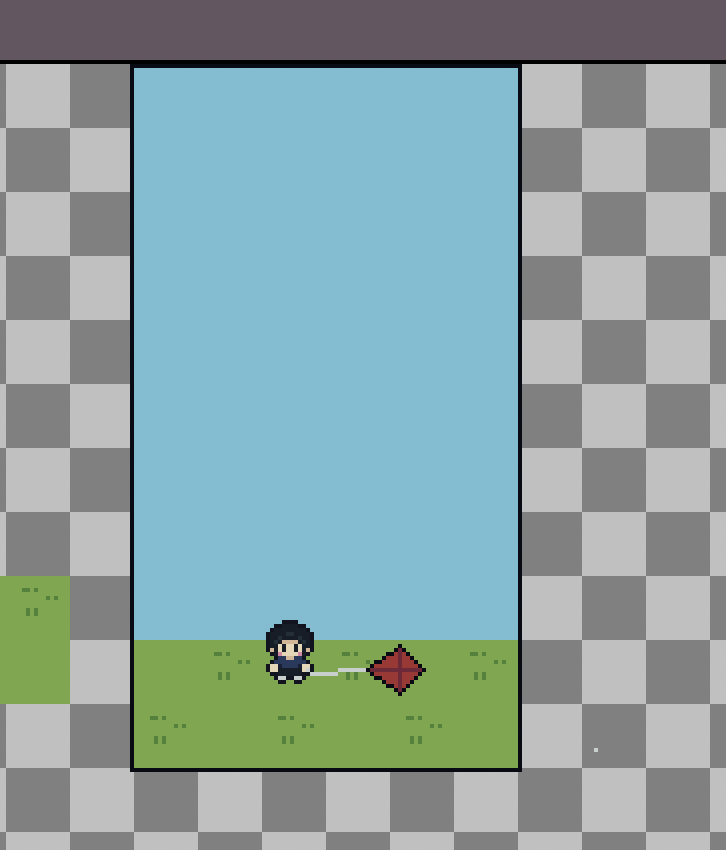

# Rise: Game Specification

Living draft. Last updated: November 17, 2026.

This document records Lucas's game design as he supplies it. It describes intended behavior, not what is currently implemented. Unspecified details remain open.

## Format

- A vertical phone game in portrait orientation.
- An upward, infinite-scrolling game centered on flying a kite.
- Preserve the artwork's relative sizes: use one shared pixels-per-unit import scale and keep sprite transforms at their original scale.

## Starting scene

- The game starts in the state shown in the reference, with a child on the ground holding the kite.
- The game waits for the player's first swipe before launching the kite and starting the camera's upward movement.
- The reference shows pixel art, a grassy ground area, a child, a red kite, and blue sky above.
- Use the framed portrait area as the gameplay reference. The surrounding editor area is not part of the game screen.

## Player controls and kite movement

- The player controls the wind by swiping across the screen.
- A swipe anywhere on the screen affects the kite; it does not need to be near the kite.
- Each swipe produces wind with both a direction and a strength.
- Wind strength depends mainly on swipe speed, with swipe distance having a smaller effect.
- Swipe speed has a slightly stronger influence in the current tuning (weight 2.6, previously 2.2); maximum gust strength is also increased from 4.2 to 5.0.
- This wind acts on the kite and affects its movement.
- The kite has momentum, so its movement carries over rather than resetting between swipes.
- The decorative kite string is a single thin line at 25% opacity.
- Gravity gradually pulls the kite down when the player stops swiping.
- Coasting should look smooth between physics updates. Visual tilt and the shield rotate together separately from the physics body.
- Kite handling stays consistent throughout a run: height does not change wind strength, gravity, drag, turning, or maximum speed.
- For now, the kite bounces back when it reaches the left or right screen edge. This behavior is provisional.
- The formula combining swipe speed and distance, and the exact physics values, are not yet specified.

## Wind feedback

- Each swipe creates a brief gust across the screen using Lucas's original wind pixel.
- Use 6–10 streaks per gust, with base lengths of 6–12 pixels and small natural variations. Align the streaks with the swipe direction, with stronger swipes producing faster, longer, slightly denser gusts.
- Space streaks fairly evenly across the screen, with small random offsets so the gust still feels natural.
- Wind streaks reach 50% opacity during the gust, then fade out; the original exported pixel remains unchanged.
- Gusts fade after roughly half a second, behind the kite and obstacles.
- Preserve one-pixel thickness relative to the other artwork, repeating the pixel along each streak's length.
- Clear the effect when the run ends or restarts.

## Camera and environment

- The camera follows the kite's upward progress but does not follow it back down.
- During ascent, the camera keeps the kite at or below roughly 54% of the screen height measured from the bottom, leaving more room to see approaching hazards.
- The kite can move downward, but the player needs to keep progressing upward. Lucas's reference is the forward-progress pressure in Crossy Road.
- The camera also moves upward automatically at 0.5 world units per second, even when the kite stops climbing (previously 0.42).
- If the kite falls off the bottom of the screen, the run ends immediately.
- The area above the ground is blue sky with occasional clouds drifting slowly in the distant background.
- Clouds sit behind all gameplay and scroll much more slowly than the kite and obstacles, creating depth through parallax. Preserve their original sprite scale and use softer opacity.
- Clouds are decorative and do not collide with the kite.
- The game continues scrolling upward as the kite gains height.

## Dangers

- The kite encounters dangers as it gets higher.
- Examples include birds and saws. This is not a complete hazard list.
- For the current prototype, use only the small saws, spinning at 360 degrees per second.
- Saw positions use a single screen-wide range that includes the borders; at least half of each saw stays visible.
- Hitting a hazard ends the run immediately unless the kite is protected by a shield.
- Current saw behavior and placement follow the height-based difficulty rules below.

## Height-based difficulty

- Difficulty follows maximum height: the prior checkpoint height-400 difficulty value now appears at 100. Density continues increasing toward the existing cap at 500; kite handling remains constant.
- Generate irregular 2D placements in upcoming areas. Target roughly 5 saws per 8 units at height 100, increasing to 8 at 500. These are ceilings: reject unsafe placements instead of forcing the target count.
- Prefer well-separated 2D candidates using a capped reward plus randomness; occasional pairs remain possible. Moving amplitudes are 1–1.55 units (2–3.1 end to end), subject to full-sweep clearance. Failed moving placements can fall back to stationary saws.
- Saws can share the same height. Keep their full horizontal sweep envelopes at least 1.5 units apart in 2D and reject heavy local clustering.
- Sample positions across the screen, including its borders. There is no special border chance or alternating-side rule. Keep moving saw centers within the screen throughout their sine cycles so at least half stays visible.
- Do not reserve a centered passage. Reject connected chains of swept saw capsules spanning both usable screen borders, including diagonal walls. Expand sweeps by saw radius, kite radius, and 0.16 units of margin. This prevents geometric barriers at every sine phase; it does not prove that every route is comfortable with momentum.
- Moving saws are disabled until the player reaches maximum height 50. Newly generated saws can move from then onward; existing stationary saws remain stationary. The height-scaled moving probability approaches 40% at 500, with realized proportions potentially lower after placement rejection.
- Keep sine-wave motion. Average travel speed is randomized within 0.55–0.85 units/second initially, 0.75–1.1 at height 33.33, and 0.95–1.4 at 500. Turning-point velocity can reach zero. Calculate angular frequency from amplitude and average speed.
- Keep small 1.4-unit safe pockets around shields at randomly chosen horizontal positions, reserved before spawning nearby saws. Do not clear a whole row.
- Existing saws retain their spawn-time movement settings. Kite handling and camera speed do not scale with height. Restart resets the course.

## Power-ups

- Power-ups appear inside bubbles.
- Shield bubbles spawn at regular heights of 50, 100, 150, and so on, measured from the kite's starting height. Their interval stays fixed as saw difficulty changes, and restart begins again at 50.
- The first power-up is a shield that protects the kite from one hazard hit. That hit consumes the shield instead of ending the run.
- The shield activates automatically when the kite touches its bubble.
- While protected, show the `kite-shield` artwork around the kite at the same pixel scale.
- The shield has no time limit; it remains active until it absorbs a hit.
- When the shield breaks, the kite blinks every 0.1 seconds during 0.9 seconds of temporary invincibility, 50% longer than the previous 0.6 seconds. It becomes steadily visible again when this protection ends. Blinking does not affect kite movement.
- Shields do not stack. Collecting another shield while protected does not increase protection beyond one hit.
- Any additional power-up types are not yet specified.

## Scoring

- The score is based on the highest height the kite reaches during a run.
- Height units and the conversion from height to score are not yet specified.

## On-screen display

- Remove titles, instructions, status labels, and game-over wording from the game screen.
- During a run, show only the height score in a pixel font at the top left.
- On losing, turn the screen black and show the height centered in a pixel font.

## Further details

Additional rules and design decisions will be added as Lucas describes them. Any additional failure conditions and other unmentioned mechanics remain open.

- Saw appearance: stationary saws use `saw-grey`; moving saws use the small red `saw2` sprite. Both retain 16 pixels per world unit and rotate around their visual centers.
