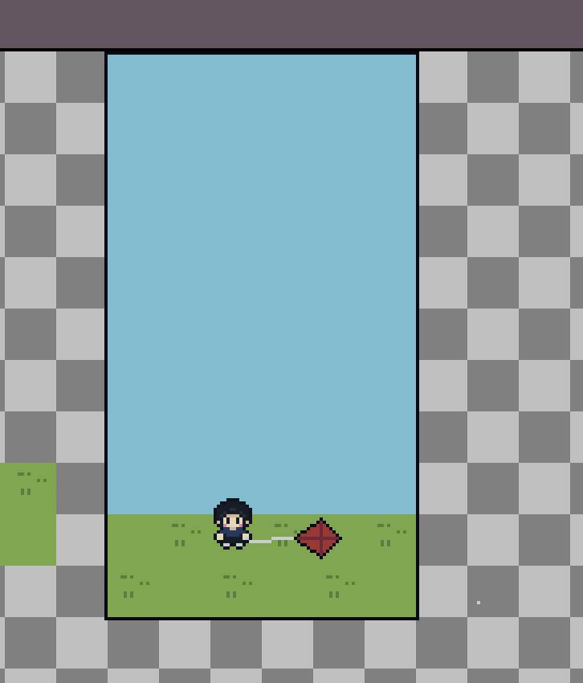

# Rise: Game Specification

Living draft. Last updated: November 13, 2026.

This document records Lucas's game design as he supplies it. It describes intended behavior, not what is currently implemented. Unspecified details remain open.

## Format

- A vertical phone game in portrait orientation.
- An upward, infinite-scrolling game centered on flying a kite.
- Preserve the artwork's relative sizes: use one shared pixels-per-unit import scale and keep sprite transforms at their original scale.

## Starting scene

- The game starts in the state shown in the reference, with a child on the ground holding the kite.
- The game waits for the player's first swipe before launching the kite and starting the camera's upward movement.
- The reference shows pixel art, a grassy ground area, a child, a red kite, and blue sky above.
- Use the framed portrait area as the gameplay reference. The surrounding editor area is not part of the game screen.

## Player controls and kite movement

- The player controls the wind by swiping across the screen.
- A swipe anywhere on the screen affects the kite; it does not need to be near the kite.
- Each swipe produces wind with both a direction and a strength.
- Wind strength depends mainly on swipe speed, with swipe distance having a smaller effect.
- This wind acts on the kite and affects its movement.
- The kite has momentum, so its movement carries over rather than resetting between swipes.
- Gravity gradually pulls the kite down when the player stops swiping.
- For now, the kite bounces back when it reaches the left or right screen edge. This behavior is provisional.
- The formula combining swipe speed and distance, and the exact physics values, are not yet specified.

## Wind feedback

- Each swipe creates a brief gust across the screen using Lucas's original wind pixel.
- Use fewer, longer streaks made from the wind pixel. Align the streaks with the swipe direction, with stronger swipes producing faster, longer, slightly denser gusts.
- Space streaks fairly evenly across the screen, with small random offsets so the gust still feels natural.
- Gusts fade after roughly half a second, behind the kite and obstacles.
- Preserve one-pixel thickness relative to the other artwork, repeating the pixel along each streak's length.
- Clear the effect when the run ends or restarts.

## Camera and environment

- The camera follows the kite's upward progress but does not follow it back down.
- The kite can move downward, but the player needs to keep progressing upward. Lucas's reference is the forward-progress pressure in Crossy Road.
- The camera also slowly moves upward automatically, even when the kite stops climbing.
- If the kite falls off the bottom of the screen, the run ends immediately.
- The area above the ground is blue sky with occasional clouds drifting slowly in the distant background.
- Clouds sit behind all gameplay and scroll much more slowly than the kite and obstacles, creating depth through parallax. Preserve their original sprite scale and use softer opacity.
- Clouds are decorative and do not collide with the kite.
- The game continues scrolling upward as the kite gains height.

## Dangers

- The kite encounters dangers as it gets higher.
- Examples include birds and saws. This is not a complete hazard list.
- For the current prototype, use only the small saws and make them spin faster.
- Hitting a hazard ends the run immediately unless the kite is protected by a shield.
- Hazard behavior and placement are not yet specified.

## Power-ups

- Power-ups appear inside bubbles.
- The first power-up is a shield that protects the kite from one hazard hit. That hit consumes the shield instead of ending the run.
- The shield activates automatically when the kite touches its bubble.
- While protected, show the `kite-shield` artwork around the kite at the same pixel scale.
- The shield has no time limit; it remains active until it absorbs a hit.
- Shields do not stack. Collecting another shield while protected does not increase protection beyond one hit.
- Any additional power-up types are not yet specified.

## Scoring

- The score is based on the highest height the kite reaches during a run.
- Height units and the conversion from height to score are not yet specified.

## On-screen display

- Remove titles, instructions, status labels, and game-over wording from the game screen.
- During a run, show only the height score in a pixel font at the top left.
- On losing, turn the screen black and show the height centered in a pixel font.

## Further details

Additional rules and design decisions will be added as Lucas describes them. Any additional failure conditions and other unmentioned mechanics remain open.
